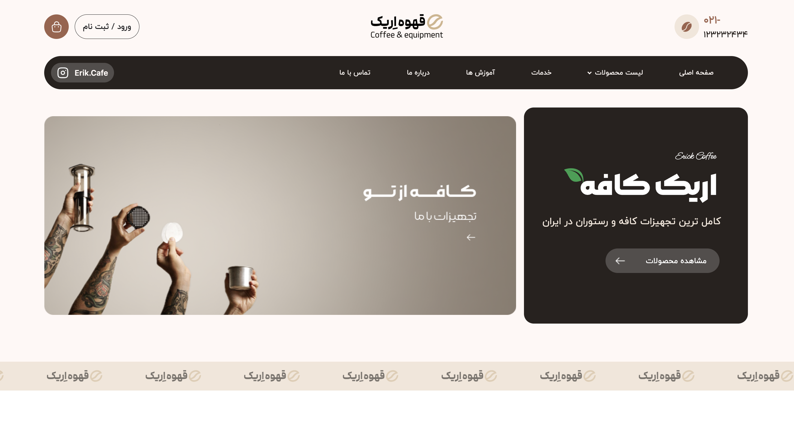
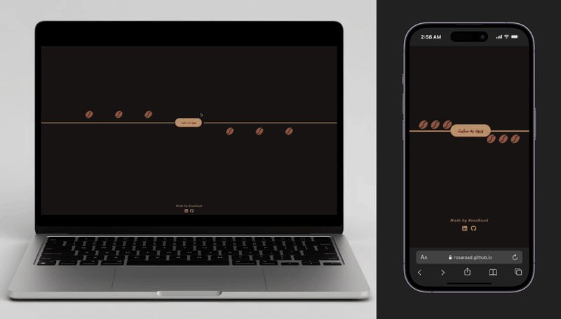

# ☕ Coffee Shop Website

A responsive coffee shop website built from a Figma design using HTML, Tailwind CSS, DaisyUI, and Swiper.js.

This project focuses on translating a Figma design into a clean, modern, and responsive user interface.

## 📸 Preview

## 🎥 Demo

## ✨ Features

- Responsive design for desktop and mobile devices
- Modern UI based on Figma design
- Interactive slider using Swiper.js
- Hover effects and smooth interactions
- Styled components with Tailwind CSS and DaisyUI

## 🛠️ Built With

- HTML
- Tailwind CSS
- DaisyUI
- Swiper.js
